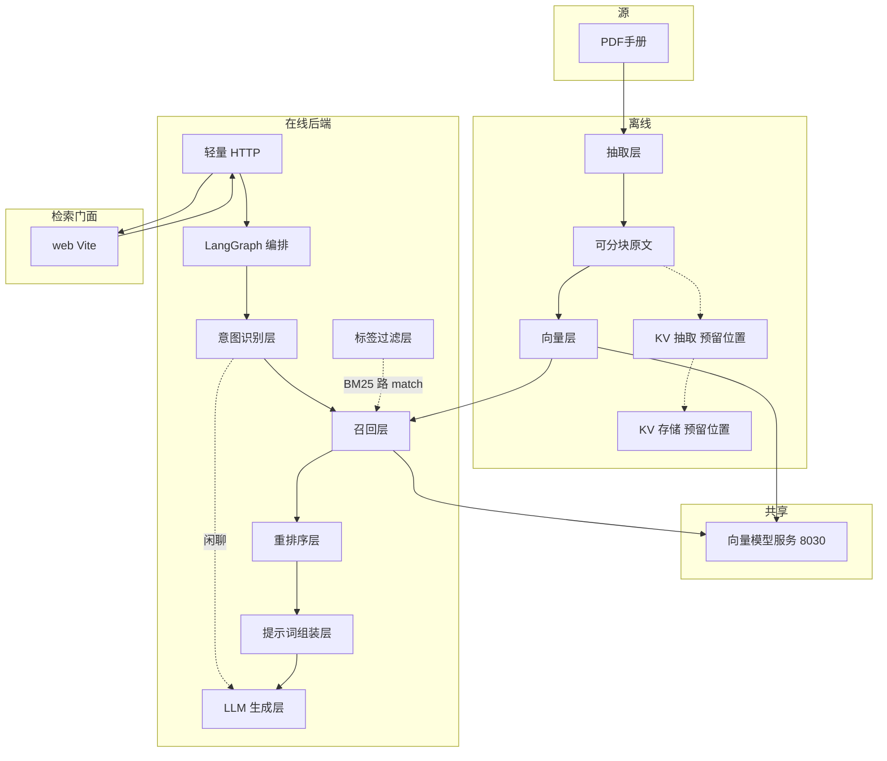
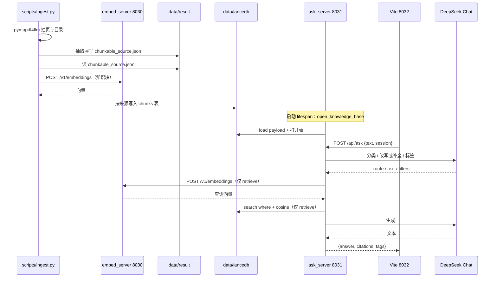
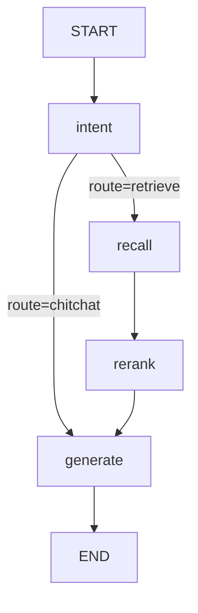

# book-nav-rag 目标架构

BookNav-RAG（目录导航问答）的目标态：层、流向、位置（放哪个目录）、状态。术语见 [CONTEXT.md](../CONTEXT.md)。现行为什么这样见 [adr.md](adr.md)；废决策见 [HISTORY.md](HISTORY.md)。写代码以本文与 [AGENTS.md](../AGENTS.md) 为准，不要把 HISTORY 里的旧选定当禁止条款。产品仓原词见 [docs/compare.md](compare.md)。检索面试问答见 [docs/questions/](questions/)。怎么跑见 [README.md](../README.md)。

本文不是术语表，不是使用指南。状态：已实现 / 内联 / 未做 / 明确不做。

---

## 1. 系统是什么

book-nav-rag 是通用 RAG 知识库：把约定格式的文档变成一份知识库，按印刷目录把每页归到对应章节、抽正文并自动抽出复数过滤标签，再按检索内容回答问题。输入是查询文本，输出是答案文本与页码引用。不是 SaaS 管理平台，不从产品仓 fork。样本可以是汽车手册；手册不是库的领域定义。

默认检索单元是知识块。KV 条目是可拆的支线（可选的另一条路，不是必做）：存储可由 KV 实验脚本写入；查询侧不进召回。

一份逻辑知识库，可含多个来源。来源是文档身份，每份都有，也是唯一强制筛选的维。过滤标签是入库从正文抽出的 `{field, value}` 列表，字段名不预置；不是库边界。查询时由意图识别对照库内已出现的来源与标签对给出候选，标签按**命中条数给候选加权**，不直接按字段做强制筛选（ADR-0035），不是用户手填。

源格式目标态仍含 PDF、Office（docx/xlsx）、纯文本/Markdown、URL/HTML；音视频明确不做。本阶段路由只登记 PDF：基础信息 → 路由 → 本仓 pymupdf4llm 抽页 → 内容生成信息 → collect 写出可分块原文。响应带印刷目录区间时方式名记 handbook，无目录记 pdf。`anyurl.py` 是还没接进流程的预留实现文件。汽车手册是这种样本，不是抽取开关。MinerU / anydoc 未决，不进路由登记则不进流程。图片 OCR 是 `vlm_ocr.py` 预留实现文件，本阶段不调用、不排期。

在线主入口是一个轻量 HTTP 接口。命令行调试走同一条图。检索门面是独立前端 `web/`，只调该 HTTP 接口展示问答；没有该页，接口与脚本仍能问。引用在侧栏展示，对象仍是引用；侧栏跟当前点开的那条助手消息走。

编排：在线主路径用 LangGraph 图把各层连起来依次调用；生成节点用 LangChain `prompt | model | parser`。`create_agent` / `create_deep_agent` 不进主路径。

**明确不做**：

| 项 | 原因 |
|----|------|
| 主路径 Agent / Deep Agent / GraphRAG | RAG 是检索后生成，不是模型选工具；图检索不是本仓下一层 |
| RBAC、任务队列、管理 UI、产品级 HTTP API 网关 | 产品平台不做；一个轻量 POST 接口 + 一页对话见 ADR-0012 |
| 把样本领域写成约定的字段（`brand`/`car` 列） | 第一份样本是汽车手册，不是库的领域。见 ADR-0026 |
| 评测台产品 | 只留最小评测口的预留位置 |
| 自建解析微服务；把 anyurl2text / MinerU / anydoc 引进本仓 | 外仓源码不引进；手册 PDF 抽页在本仓 `methods/pdf.py`；与 anyurl2text 抽取解耦。见 ADR-0016、ADR-0034 |
| 按格式堆源适配器 | 抽取方式可插拔，增删靠路由登记 |
| 抽取目录里放流程用不到的测试文件 | 入库与测试在 `scripts/ingest.py` |
| 为完整而双写 KV | KV 是预留位置；查询侧不接，不把 KV 当第二套必建库 |
| 把 KV 再向量化当默认 | 精确匹配会丢 |
| 音视频入库 | 不在格式清单里 |
| 在 extract/ 或 vector/ 写入库总编排 | 入库脚本是 `scripts/ingest.py`，见 ADR-0019 |
| 把向量模型服务实现放进 `offline/` 或 `online/` | 入库和提问都调它；落仓库根 `embed/`。见 ADR-0018 |
| 为向量匹配再开关系库或文档库 | 检索行同表进 LanceDB。见 ADR-0024 |

---

## 2. 目标态模块

按层画。HTTP 只调在线图；图内查库走召回层。检索门面是独立前端，只调 HTTP。谁调谁、对象怎么传见第 3 节。



主路径常开：离线是「抽取 → 可分块原文 → 向量层」；在线后端是「查询 → 意图识别 → 过滤 → 召回 → 组提示 → 生成」。检索门面只展示该结果。没有检索门面，轻量 HTTP 与命令行脚本仍能问。

抽取层内部：基础信息 → 路由 → 抽取方式 → 内容生成信息 → collect。向量层内部：分块 → 调向量模型服务 → 写入 `data/lancedb` 的 `chunks` 表（BM25 在召回 load 时用同一批正文建）。两层不互相 import 对方的入口；接点是 `chunkable_source.json`。人对库入库走 `scripts/ingest.py`（先抽取再向量）。向量模型服务是共享进程：离线入库和在线召回都 HTTP 调 8030；实现与下载不进 `offline/`。

抽取层文件各管什么：

| 文件 | 输入 | 输出 |
|------|------|------|
| `probe.py` | 源路径 | 基础信息 `{path, source, name, size_bytes, ext}` |
| `route.py` | 基础信息 | 仅 PDF 走本仓抽页；非 PDF 拒绝；有目录区间则方式名 handbook |
| `methods/pdf.py` | 基础信息 | pymupdf4llm 抽页；有印刷目录则带 `{kind, pages, catalogue_ranges}` |
| `methods/anyurl.py` | — | 预留实现文件、还没接进流程；原外仓 `/rag/extract/file` 已下线 |
| `enrich.py` | 文件内容原文片段 | `tags[{field, value}]`。字段名随文档变，不预置。不把来源身份写成标签 |
| `collect.py` | probe + 文件内容 + 标签 + 方式名 | `chunkable_source.json` |
| `entrance.py` | 源路径 | 串上面五步。不写领域常量。 |

印刷目录的页与区间由本仓 `methods/pdf.py` 从 PDF 抽出。`vlm_ocr.py` / `anyurl.py` 仍在 `methods/`，本阶段流程不 import。登记表只登记本仓 PDF。

向量层文件各管什么：

| 文件 | 输入 | 输出 |
|------|------|------|
| `chunk.py` | 可分块原文 | 知识块。有 `pages` 且有目录区间则先按目录分页再按标题拼 |
| `store.py` | 知识块 + 向量 | LanceDB `chunks` 表（含 `tags`、`catalogue_title`）。Hash / HTTP 客户端同文件 |
| `entrance.py` | `chunkable_source.json` | `step4_chunks.json`；按来源写入 `data/lancedb` |

向量层不 import 抽取方式。接点仍是磁盘上的可分块原文。

在线后端六层。过滤是层，图上不是节点：来源可走 LanceDB `where`；动态标签在 payload 上精确匹配。检索门面不是第六层之外的第七层，是独立前端。

| 层 | 模块（逻辑；不等于立刻拆文件） | 文件现状 |
|----|------------------------------|----------|
| 意图识别 | 分类；改写/跟进补全；标签候选 | `intent/classify.py`、`rewrite.py`（候选现写在 classify） |
| 标签过滤 | 空过滤；`filters→tags` 形状；来源强制筛选 `source_matches`、标签加权 `tag_match_count` | `filter/tags.py` |
| 召回 | 启动装库；每问 search；重排后同节邻块 | `recall/retrieve.py` 一个文件，不拆 |
| 重排序 | 截 TOP_K（不换序） | `rerank/overlap.py`（文件名仍 overlap） |
| 提示词组装 | 命中→提示变量与 citations 大致结构 | `prompt/assemble.py` |
| LLM 生成 | 闲聊；拒答；按命中生成 | `generate/answer.py` |

不是层：`graph.py` 编排；`router.py` / `schema.py` 轻量 HTTP；`conf/base.py`（在线布尔只剩 `USE_REWRITE`；抽取无开关）；检索门面 `web/`。

图状态（`AskState`，不进第 8 节数据约定）：`question` 用户原文；`text` 检索用问句；`session`；`filters`；`hits`；`answer`；`citations`；`tags`；`route`；`turns`。HTTP 入 `AskBody{text, session, filters}`，出生成结果。`run_ask_graph` 出 `{answer, citations, tags}`。

在线各模块输入输出：

| 模块 | 输入 | 输出 |
|------|------|------|
| `format_turns` | `turns[{question, answer, route}]`，可带 `tags`；可选只收 retrieve 轮 | 历史文本（有 tags 则加筛选行），无轮则 `""` |
| `classify_route` | 用户原文 `question`；全历史文本 | `route`：`retrieve` 或 `chitchat`。有历史且问文档身份则 retrieve |
| `rewrite_query` | 用户原文；仅检索轮历史 | 检索用 `text`（开关关掉且不像跟进则原样） |
| `infer_query_filters` | 用户原文；`tag_catalog()`；检索轮历史 | `{source, tags[{field, value}]}`。source 空串=不限来源；tags 空=不加权。问句字面命中目录值就直接返回（不调模型）；调用方 `filters` 非空则覆盖，不跑本函数 |
| `empty_filters` | 无 | `{source:"", tags:[]}` |
| `tags_from_filters` | `filters` | 生成结果里的 `tags[{field, value}]`。source 非空时带 `{field:"source", value}` |
| `source_matches` | 记录 `source`；`filters` | 是否保留。来源相等（强制筛选），空串则该维不限。向量路的 `source` 走 LanceDB `where`，BM25 路在这里筛 |
| `tag_match_count` | 记录 `metadata`；本轮 `tags` | 命中标签条数（0=不加权）。**只进排序加权，不丢记录**（ADR-0035）；同一对只算一次 |
| `open_knowledge_base` / `load` | 磁盘 `data/lancedb`（进程启动一次） | 已 load 的 `KnowledgeBase` |
| `tag_catalog` | 已 load 的库 | `{sources:[...], tags:[{field, value}, ...]}` 库内已出现、去重 |
| `retrieve_hits` | 已 load 的库；检索用 `text`；`filters` | 候选命中（混合检索约 20 条）。内部：问句向量化 → `search` |
| `KnowledgeBase.search` | 查询向量；`filters`；`top_k`；查询原文 | 候选命中。来源强制筛选后 LanceDB 余弦近邻、BM25、RRF 截候选窗口，再按命中标签条数加权（`TAG_BOOST_PER_HIT`，封顶 `TAG_BOOST_MAX`） |
| `rerank_hits` | 候选命中；检索用 `text` | 同形状命中，长度 ≤ `TOP_K`。保持召回序只截断 |
| `expand_hits_by_catalogue` | 已截 `TOP_K` 的命中 | 同形状命中。按目录标题并邻块；空标题不并；同标题去重 |
| `assemble_handbook_inputs` | 检索命中；用户原文 `question`；本轮 `tags` | `{question, identity, excerpts}` + `citations[{id, source, pages, snippet}]` |
| `step3_chitchat` | 用户原文 `question` | `{answer, citations:[]}` |
| `should_refuse` / `refuse_result` | 命中列表 / 用户原文 | 是否拒答；拒答时 `{answer: REFUSE_TEXT, citations:[]}` |
| `step3_generate` | 检索命中；用户原文 `question`；本轮 `tags` | `{answer, citations}`。调组提示再 LLM |

图节点：intent 写 `route` / `text` / `filters` / `tags`（闲聊则 `hits=[]` 并跳过召回）；recall 写 `hits`；rerank 改 `hits`（先截 `TOP_K`，再并同节邻块）；generate 写 `answer` / `citations` 并追加 `turns`（含 `text` / `tags` / `filters`）。`tags` 在 intent 写出，generate 不改。闲聊与检索生成都用 `question`；召回用改写后的 `text`。身份追问沿用上一轮筛选和检索问句。

抽取方式规范：输入是基础信息（含路径）；输出是文件内容（有页则 `pages[{page,text}]`，无页则 `text`；目录区间可选）。方式不写可分块原文、不抽过滤标签、不分块、不向量、不碰 KV。本阶段仅 PDF 本仓抽页。响应带目录区间则方式名 handbook。增方式：加 `methods/` 文件并在路由登记一行。删方式：去掉登记。不按样本文件名切换。见 ADR-0031、ADR-0034。

意图识别做分类与改写，并用条件边决定是否检索：闲聊跳过召回与重排，生成无引用，不是拒答。历史只进入意图识别，检索针对本轮问题或改写后的查询。

开关：改写默认开。重排节点把候选截成 `TOP_K`（ADR-0027）。拒答留在图上（空命中或向量余弦低于阈值则用拒答文案，`citations` 可空）；KV 抽取挂在可分块原文之后，实验脚本在 `scripts/backup/`，不进抽取 `entrance`、不进召回；图片 OCR 在 `vlm_ocr.py` 上未做，本阶段不调用；最小评测口是独立脚本。启用与关闭使用同一套数据对象。查询侧 KV 与词重叠重排已删除，见 ADR-0030。

学习预留位置：`scripts/` 下 `create_agent` / `create_deep_agent` 沙箱，不接提问口。本阶段不排期。

---

## 3. 步骤调用

第 2 节是层边界。本节是运行时谁调谁。离线脚本跑完即退出；在线是三个长驻进程（问答 8031、向量 8030、Vite 8032）。手册抽取不依赖 anyurl2text。接点是磁盘上的 `data/result/<source>/chunkable_source.json`（抽取产出）与 `data/lancedb/`（向量层产出，表 `chunks`；KV 支线另写 `data/result/kv/kv_store.json`）。问答进程启动时 load 一次，不在提问时重读。入口是仓库根 `ask_server.py`。

现状入口见 README。下面是目标调用。

### 进程怎么接



命令行 `scripts/query_kb.py`（单轮）与 `scripts/chat_kb.py`（多轮同一 session）和 HTTP 共用 `run_ask_graph`，不经过 Vite。入库是 `python scripts/ingest.py`。长驻问答永远 `python ask_server.py`：该文件只创建 FastAPI、`include_router`、注册 lifespan；`POST /api/ask` 在 `online/router.py`。不要 `python online/router.py`，包内不留第二份 `__main__`。

### 离线：入库

入口 `python scripts/ingest.py`。每份源：抽取层再向量层。仅 PDF 本仓抽页；不依赖 anyurl2text。OCR 本阶段不调用。前提：向量层须 `embed_server.py` 已启动。改完分块策略只重跑向量层用 `python scripts/ingest.py --vector-only`：重复使用已有的 `chunkable_source.json`，不重跑抽取，也不重跑 enrich 的 LLM 抽标签。

```text
scripts/ingest.py
  step1_extract
    extract.entrance.run_extract
      probe / route / methods / enrich / collect
                                         # → chunkable_source.json
  step2_vector
    vector.entrance.run_vector
      chunk                              # → step4_chunks.json（页码块级）
      POST 8030
      store                              # → data/lancedb chunks 表
```

抽取层与向量层的 `entrance.py` 只提供函数，没有 `__main__`。

### 在线：一问

入口 `web` → `ask_server.py`。图节点在 `online/graph.py`。



```text
App.askQuestion                          # web/src
  POST /api/ask                          # ask_server include → online/router.py
    run_ask_graph                        # graph；thread_id = session
      intent
        format_turns                     # 分类用全历史；改写只用检索轮
        classify_route                   # 套话或 Chat JSON
        rewrite_query                    # 开关默认开；关则仅跟进补全
        infer_query_filters              # 子串或 Chat JSON；跟进/身份追问可沿用上一轮
        tags_from_filters                # filter/tags
      recall                             # 仅 retrieve
        retrieve_hits                    # online/recall；评测与测试传 write_debug=False
          HttpEmbedder.embed_texts       # POST 8030；失败 → retrieve_hits_by_bm25（词面兜底，命中带 lexical_fallback）
          KnowledgeBase.search
            LanceDB where + cosine
            source_matches + BM25
            RRF + 标签加权               # 截候选窗口；score=RRF+标签加权；vector_score=余弦
      rerank_hits                        # 截 TOP_K
      expand_hits_by_catalogue           # 同节邻块；空标题不并
      generate
        step3_chitchat                   # CHITCHAT_PROMPT | model | parser
        或 should_refuse → refuse_result  # 空命中或余弦低于阈值
        或 step3_generate
          assemble_handbook_inputs
          HANDBOOK_PROMPT | model | parser
        追加 turns                       # 给下一轮 intent
```

闲聊不调 `retrieve_hits`，因此不打 embedding、不写 `step2_hits.json`。检索用的是改写或补全后的 `text`，不是用户原文。生成用原文 `question`；检索生成另带文档身份 `tags`（芯片同源），用来回答来源/品牌/车型。

同一条检索核心另有离线入口 `ask_once_core`（`online/graph.py`）：与 intent / recall / rerank 同一顺序，停在生成前，给 `scripts/eval_kb.py` 与 pytest 用；评测与线上因此不会各走一套。

---

## 4. 目录位置

新代码放到下表的位置，不另起目录，不把逻辑搬回已删除的 `ingest/` `utils/` `query/`。问答不进抽取脚本。抽取目录只放流程会调用的模块。长驻服务只从仓库根 `ask_server.py` / `embed_server.py` 启动。跑完即退出的入库、评测、下载、调试用 `python scripts/...`。不要用 `python online/...` 启动进程。下载用 `python scripts/download_embed.py`。

```text
conf/base.py       ROOT；向量/在线阈值与提示词；在线布尔只剩 USE_REWRITE
conf/config.yaml   相对 data/models/lancedb 目录名
.env / .env_example  第三方地址与密钥；.env 不进 git
ask_server.py      问答 HTTP：HOST/PORT、create、注册路由、lifespan
embed_server.py    向量模型服务：HOST/PORT
embed/
  server.py        服务实现
offline/
  extract/         抽取层（停在可分块原文）
    probe.py
    route.py
    methods/pdf.py             本仓 pymupdf4llm 抽页
    methods/anyurl.py          预留实现文件，还没接进流程（原外仓 RAG 口已下线）
    methods/vlm_ocr.py         预留实现文件，本阶段不调用
    enrich.py
    collect.py
    entrance.py
  vector/          向量层（可分块原文 → 向量库；HTTP 调 8030）
    chunk.py
    store.py               LanceDB chunks 表 + BM25；Hash / HTTP 客户端同文件
    entrance.py
  store/kv_store.py        KV 支线，不进向量层
online/
  router.py        POST /api/ask
  schema.py        AskBody / Generation 等
  graph.py         LangGraph 编排（状态、边、checkpointer）
  intent/          意图识别层
  filter/          标签过滤层
    recall/          召回层（装库 + search；search 内先过滤）
  rerank/          重排序层（截 TOP_K）
  prompt/          提示词组装层
  generate/        LLM 生成层（含引用字段）
web/               检索门面：独立前端，只调 8031（Vite 8032）
data/              样本与产出（result 按来源；lancedb 为向量库目录）
models/            本地 embedding 权重
scripts/           入库 ingest.py（--vector-only）、入库验收 verify_ingest.py、单轮 query_kb.py、多轮 chat_kb.py、最小评测口 eval_kb.py、KV 实验、download_embed、Agent 学习沙箱
```

| 层 | 路径 |
|----|------|
| 抽取层 | `offline/extract/` 上列文件 |
| 抽取方式 | `offline/extract/methods/pdf.py`（本仓；方式名 handbook/pdf）；`methods/anyurl.py`（预留实现文件，还没接进流程） |
| 向量层 | `offline/vector/`（chunk / store / entrance；HTTP 调 8030；库在 `data/lancedb`） |
| 向量模型服务 | `embed_server.py`；实现 `embed/server.py`；下载 `scripts/download_embed.py`；权重 `models/` |
| KV 存储 | `offline/store/kv_store.py`；KV 实验在 `scripts/backup/` |
| 入库 | `scripts/ingest.py`（`--vector-only` 只重跑向量层） |
| 入库验收 | `scripts/verify_ingest.py`（只读；硬断言未过则非零退出） |
| 层与模块常量 | `conf/base.py`（抽取无开关） |
| LangGraph 编排 | `online/graph.py`（条件边；recall 调 `retrieve_hits`） |
| 意图识别层 | `online/intent/rewrite.py`，`classify.py` |
| 标签过滤层 | `online/filter/tags.py` |
| 召回层 | `online/recall/retrieve.py`（`KnowledgeBase`、`retrieve_hits`、`retrieve_hits_by_bm25`、`open_knowledge_base`） |
| 重排序层 | `online/rerank/overlap.py` |
| 提示词组装层 | `online/prompt/assemble.py` |
| LLM 生成层 | `online/generate/answer.py` |
| 轻量 HTTP | `ask_server.py`（入口）+ `online/router.py` + `online/schema.py` |
| 检索门面 | `web/`（独立前端，调轻量 HTTP） |
| 最小评测口 | `scripts/eval_kb.py` + 样本 `scripts/eval_samples.json`（经 `online/graph.py::ask_once_core`） |
| 测试缝 | `tests/`（`conftest.py` 把仓库根放进 `sys.path`） |
| 命令行单轮 | `scripts/query_kb.py` |
| 命令行多轮 | `scripts/chat_kb.py` |
| Agent 学习沙箱 | `scripts/` |
| 手册样本 | `data/source/` |
| 产出 | `data/result/`；向量库 `data/lancedb/` |

---

## 5. 状态标记

| 层 | 状态 |
|----|------|
| 抽取层（probe / route / collect / entrance） | 已实现（entrance 不再写领域常量；源文件只认 `SOURCE_ALLOWED_SUFFIXES`，不在允许清单里就跳过并打日志） |
| 抽取方式 | 已实现（仅 PDF 本仓抽页；anyurl 预留实现文件还没接进流程。印刷目录**动态扫**：带表头的页 + 紧邻的续页，连续 `EXTRACT_CATALOGUE_STOP_PAGES` 页不是目录页就停，不再写死页数） |
| 内容生成信息 enrich | 已实现（动态 `{field, value}`，最多 8 条；来源不写入 tags。抠 JSON 用**花括号配对**逐段试解析（不用贪婪正则，两个对象的输出照样能取出 tags）；抽空打原因与模型原始输出，并在入库汇总里按名字单列——「抽不出标签的文档」不许混进「成功 N」） |
| 向量层目录 `offline/vector/` | 已实现（按目录分页在 `chunk.py`；**页码块级**——同一节切出的每个子块只声明自己覆盖的页；LanceDB 在 `store.py`；客户端按 `EMBED_REQUEST_BATCH` 切批并每批打进度；**写库前校验向量维数**——首次建表也过这一关，`EMBED_DIM_BY_NAME` 登记 embedder → 期望维数；`step4` 仍是调试产物，但**写库成功之后才写进磁盘**，与库永远同批；表列 `tags` JSON、`catalogue_title`） |
| 向量模型服务 `embed/` | 已实现（权重目录名走 `config.yaml` 的 `models_embedder`；`pytorch_model.bin` 与 `model.safetensors` 都认；下载走 `EMBED_MODEL_REVISION` 锁定版本，留空则日志明说没有锁定版本） |
| KV 抽取 / 存储 | 存储与实验脚本在 `scripts/backup/`；查询侧已拆（ADR-0030） |
| LangGraph 编排 | 已实现（条件边；MemorySaver `turns`） |
| 意图识别层 | 已实现（闲聊分类；改写开关默认开；历史进意图；标签候选对照库内 `{field, value}`） |
| 标签过滤层 | 已实现（`source` 强制筛选；tags 按命中条数加权、不再按 AND 强制筛选，ADR-0035） |
| 召回层 | 已实现（LanceDB 近邻；BM25 进程内；RRF 截候选窗口后按命中标签加权；重排后同节邻块；向量服务不可用则词面兜底） |
| 重排序层 | 已实现（截 TOP_K） |
| 提示词组装层 | 已实现 |
| LLM 生成层 | 已实现（`prompt | model | parser`） |
| 轻量 HTTP | 已实现 |
| 检索门面（独立前端 `web/`） | 已实现（session 已带；每条旁参考资料按钮） |
| 最小评测口 | 已实现（调 `ask_once_core`，与图同一顺序；Hit@1/@`TOP_K`，可对页；负样本看拒答；`--route` 注入用于验收「评测真在线上路径上」） |
| 入库验收口 `scripts/verify_ingest.py` | 已实现（只读；页覆盖 / **丢页原因分类**（空文本 / 清洗后为空 / 导航页三类 / 首条目录项之前 / 区间内未分到页 / 无目录区间；「真丢正文」超 `MISSING_CONTENT_MAX` 即硬问题（必须修的问题），判成章扉页却留着大段正文记「疑似误杀」）/ 页精度 / id 唯一性 / token 分布 / tags 区分度，硬断言未过则非零退出） |
| 测试缝 `tests/` | 已实现（纯函数与替身，不调 LLM、不调 8030；`python -m pytest tests`） |
| 图片 OCR | 未做（`vlm_ocr.py` 预留实现文件；本阶段不调用、不排期） |
| Agent 学习沙箱 | 未做（学习支线，本阶段不排期） |
| `scripts/ingest.py` | 已实现（入库：抽取再向量；`--vector-only` 重复使用已有可分块原文只重跑向量层） |

---

## 6. 离线数据流

1. 抽取层读一份源，经基础信息、路由、抽取方式、enrich、collect，吐出 **可分块原文**（`source`、`kind`，有页则 `pages[{page,text}]`，无页则 `text`；可选目录区间；`tags[{field, value}]` 可空）。可选、不进检索约定：`extract_method`、基础信息摘要。
2. 向量层读取可分块原文：有目录区间则按标题拼知识块，否则按段/页切；一节超限切出的每个子块只带自己覆盖的页（`_assemble_pieces_with_pages`，页码块级）。过滤标签由抽取层 enrich 从正文抽出，整份文档的 tags 写到每个知识块上。不得用手填常量或文件名冒充。不得把来源身份写成一条过滤标签。`source` 才是文档身份。
3. 向量层调向量模型服务拿向量，不实现模型、不下权重。Hash 向量只为打通流程，是调用方临时占位，不是服务实现。目标默认用语义 embedding。按来源替换写入 `data/lancedb` 的 `chunks` 表。约定的字段不变。不上第二库。不为每个标签字段加一列；tags 与 source、正文同表。`catalogue_title` 写入表列，不进检索命中约定。
4. BM25 与向量并列，同属向量层，对同一批知识块建倒排。不上独立搜索引擎。
5. KV 抽取吃可分块原文，不吃知识块；实验脚本写入 KV 存储。不进抽取 `entrance`，不进召回。

物理上抽取产出仍按来源分目录。向量库是一份 `data/lancedb` catalog。逻辑上召回层看成一份知识库。

---

## 7. 在线数据流

主入口：一个轻量 POST 接口。传入 **查询**（`text`，可选 `session`；`filters` 仅调试覆盖），打出 **生成结果**（含本轮 `tags`）。命令行调试走同一条图。检索门面 `web/` 只调该 POST：主栏一对一多轮；每条助手消息旁点「参考资料」后侧栏换该次引用；筛选芯片跟当前选中那条走。没有检索门面也能问。

1. LangGraph 用 `session` 做 checkpointer。历史在 `turns` 里，只进入意图识别层。
2. 意图识别：分类 + 改写，并对照库内来源清单与标签对给出本轮筛选。闲聊走条件边跳过召回。改写开关默认开，每轮检索问句都改写。开关关掉时，只有检索轮历史且本轮像跟进（「它」「那个」「呢」）才补全；闲聊之后的完整问句原样检索。提示词不假定汽车领域。
3. 召回层：
   - 先按 `filters.source` 强制筛选（空则该维不限）。`filters.tags` **不做强制筛选**：命中 N 条的块加 `min(N × TAG_BOOST_PER_HIT, TAG_BOOST_MAX)` 分（ADR-0035）。按字段强制筛选会把同字段多值切成 0 命中，直接让提问变成拒答。
   - 向量路：LanceDB 余弦近邻（`distance_type("cosine")`）。来源可走 `where`。
   - BM25 路：倒排。
   - 两路 RRF 融合，截到候选窗口（默认 20，见 `CANDIDATE_FLOOR`）。不在这一层截 `TOP_K`。
   - 词面兜底：embedding 调不通（`EMBED_UNAVAILABLE`）时不把异常抛给上层，退化为纯 BM25，
     命中标 `lexical_fallback=True`。向量服务挂掉不许把整个问答口打死（闲聊仍 200）。
   - 调试题材写进磁盘由 `retrieve_hits(write_debug=)` 控制，默认取 `conf/base.py::DEBUG_WRITE_QA`（**默认关**，回答路径不碰磁盘）；评测与测试传 `False`，别覆盖线上那份；打开时写 `data/result/qa/`。文件名由 `graph.py::debug_name(base, session)` 组装：带 session（只留 `[A-Za-z0-9_-]`、截到 `DEBUG_TAG_MAX_CHARS`），没有 session 就退回时间戳 + 随机，并发两问不互相覆盖（P2·31）。
4. 重排序：把候选截成 `TOP_K` 再给拒答与生成。保持 RRF 顺序只截断。截完后按目录标题把同节邻块并进命中正文（空标题不并；同标题去重；有 token 上限）。不改命中对象字段名。见 ADR-0027、ADR-0028。
5. 证据不足则生成结果为拒答文案，`citations` 仍是列表（可空）。空命中拒答；`REFUSE_MIN_SCORE` 大于 0 时，最好的 `vector_score`（余弦）低于该值也拒。不看 RRF 融合分。本轮是词面兜底时另走一套判据：没有 `vector_score` 不等于有证据，`REFUSE_ON_LEXICAL_FALLBACK` 开着就要求命中里出现查询词。
6. 提示词组装：检索命中拼进提示，不改约定的字段名。
7. 生成：LangChain `prompt | model | parser` 产出 `answer`。
8. 引用：`citations` 指向检索命中的 `id` / `source` / `pages` / `snippet`。检索门面把引用放侧栏「参考资料」，由答案旁按钮选定，不跟在气泡下。本轮筛选标签在 `tags[{field, value}]`。
9. 最小评测口：调 `ask_once_core`（分类 → 改写 → 筛选 → 召回 → 重排截 `TOP_K` → 同节邻块，停在生成前），与图的 intent / recall / rerank 同一顺序。正样本看 Hit@1 / Hit@`TOP_K`（期望来源，可再对页）；负样本看 `should_refuse`。不调生成，`write_debug=False` 不覆盖线上调试题材。`--route chitchat` 注入后正样本必须全部未命中，这是「评测真在线上路径上」的验收。不是评测台产品。

关掉任意开关，主路径对象形状不变：查询仍是查询，命中仍是命中，生成结果仍含 `citations`。

---

## 8. 数据约定

插件拆装只保证这些名字。其余进可选 metadata，不进约定。新入库写出这些字段；tags 可空，空则不加权。

### 可分块原文

必有：`source`，`kind`，以及 `pages[{page, text}]` 或无页时的 `text`。

可选：目录区间。有印刷目录的 PDF 路径应带页、目录区间。

过滤标签：`tags[{field, value}]`，可 `[]`。由抽取层 enrich 从正文抽出。字段名不预置。不要把 `source` 写入 tags。

可选不进检索约定：`extract_method`、基础信息摘要。

### 知识块

必有：`id`，`text`，`metadata.source`，`metadata.pages`（可 `[]`；**块级页码**——一节切成多块时每个子块只声明自己覆盖的页，任一页只被一个块声明）。

过滤标签：`metadata.tags[{field, value}]`，可 `[]`。继承该来源可分块原文的 tags。

可选不进约定：`catalogue_title`，`part`，`knowledge_type`。抽取入口不再写入 `knowledge_type`；旧 JSON 有则向量层仍读。`catalogue_title` 写入 LanceDB 表列，只给同节邻块用。

向量存在后端记录里，不进知识块约定。召回层返回检索命中，不把 `vector` 交给生成。不要用 `metadata.brand` / `metadata.car` 当约定的字段。

### KV 条目

必有：`id`，`key`，`value`，`metadata.source`。

可选：`metadata.tags`，便于同一套过滤。

### 查询

必有：`text`。

可选：`session`（会话 id）。`filters.source`（空串=不限来源，**强制筛选**）、`filters.tags[{field, value}]`（空列表=不加权；命中条数给候选加分，不丢记录）仅调试覆盖意图。

### 检索命中

必有：`id`，`kind`（`chunk` 或 `kv`），`text`，`score`，`source`，`pages`。

KV 命中的 `text` 用 `value`（或 `key: value`），`pages` 可 `[]`。向量路过的命中另带 `vector_score`（余弦），只给拒答与评测，不进生成约定。

### 生成结果

必有：`answer`，`citations[{id, source, pages, snippet}]`，`tags[{field, value}]`（`field` 为 `source` 或任意抽出字段；问句未点名则为 `[]`）。

---

## 9. 现状缺口

能从头跑到尾：`python scripts/ingest.py` 写出可分块原文并写入 `data/lancedb`。仅 PDF 本仓抽页，不依赖 anyurl2text。提问走 LanceDB `search().distance_type("cosine")`（lancedb 0.37.1）。在线在 `online/`、`web/`，入口是 `ask_server.py` 与 `scripts/query_kb.py`、`scripts/chat_kb.py`。语义向量、混合检索、生成引用、轻量 HTTP 接口、LangGraph 条件边已接上。

已落地、不要再写成待办：PDF 本仓抽页并与 anyurl2text 抽取解耦（ADR-0034）；向量库 LanceDB（ADR-0024）；动态过滤标签（ADR-0026）；**过滤标签改按命中条数加权、`source` 才是强制筛选**（ADR-0035）；改写默认开；拒答按向量余弦（ADR-0025）；RRF 候选窗口、重排截 `TOP_K`（ADR-0027）；同节邻块（ADR-0028）；查询侧 KV 与词重叠重排已删除（ADR-0030）；清洗保留段边界（P0·6）；源文件只认 PDF 后缀、入库失败非零退出（P2·15）；权重目录名进 `config.yaml`、下载可锁定版本、兼容 safetensors（P2·17）；写库前向量维数校验（P1·11）；调试题材默认关（P1·20，按 session 分文件仍待办 P2·31）；前端认 list 形式 `detail`（P2·24）；印刷目录动态扫描（P1·9）。`step4_chunks.json` 仍作调试。Hash / HTTP 客户端仍在 `store.py`。

### 本阶段不做

目标态仍留预留位置，不进当前 [TODO.md](../TODO.md)：

- 图片 OCR：`vlm_ocr.py` 预留实现文件；流程不调用。
- 入库后 ask 进程 reload：启动仍 load 一次；重入库要重启。
- 交叉编码器重排：重排节点只截断，不换序。对照仍走 `scripts/eval_kb.py`。
- Agent 学习沙箱：学习支线，永不接提问口，本阶段不排期。
- 拆共享 Chat 客户端：`chat_text` 仍住在生成包。

### 抽取层仍须注意

- 仅 PDF 本仓抽页；`anyurl.py` / `vlm_ocr.py` 是预留实现文件，还没接进流程。
- `enrich.py` 抽动态 tags，且 import `online.generate.answer.chat_text`。

### 在线仍须注意

- 意图分类/改写/标签同样借 `chat_text`。`chat_text` 不是生成层的对外约定。
- 标签候选函数写在 `classify.py`，逻辑上属意图层，不是过滤层。

仍须注意、不要当成没做：

- 只跑哪几份源，改 `scripts/ingest.py` 的 `PROCESS_ONLY`（名字集合，带后缀；空元组 = `data/source` 全部）。
- 改 Python 端口，改 `ask_server.py` / `embed_server.py` 顶部 HOST/PORT，然后重启。改数据目录、权重目录名（`models_embedder`）改 `conf/config.yaml`；换权重还要改 `scripts/download_embed.py` 的 `MODEL_ID` 与 `conf/base.py` 的 `EMBED_MODEL_REVISION`。改第三方地址与密钥改 `.env`。Vite 8032 仍在 `web/vite.config.ts`。
- KV 实验在 `scripts/backup/url_to_knowledge.py`（仍可打外仓 `/extract`），不进抽取 `entrance`，不进召回。
- 问答进程启动只 load 一次向量库；重新入库后要重启该进程。改完在线代码同样要重启，MemorySaver 会话会丢。
- 换 embedding 维数或 embedder 名须删掉 `data/lancedb` 后重新入库。
- `EMBEDDER_KIND=hash` 仍可跑通流程，但不是语义检索。
- 跟进补全只吃检索轮历史，且问句要像指代。改写默认启用。拒答阈值 `REFUSE_MIN_SCORE` 若误伤正样本，只改 `conf/base.py` 后重启。
- 旧 `data/lancedb` 若缺 `tags` 或 `catalogue_title` 列，打开表会报错。删目录后重跑 `scripts/ingest.py`，再重启 `ask_server.py`。
